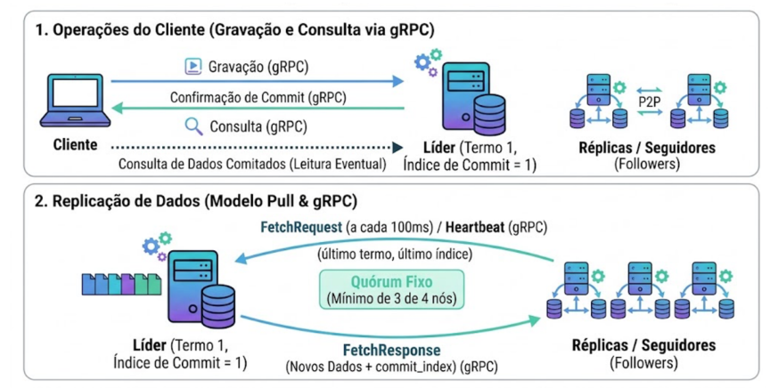

# Cluster replicado com gRPC, eleição de líder e modelo Pull

Implementação em Python de um cluster de 4 nós com replicação de dados, eleição de líder
estilo Raft e leitura eventual em qualquer nó, seguindo a figura de arquitetura do projeto.



## Visão geral

- 1 cliente e 4 nós do cluster (os 4 nós executam o mesmo código).
- Toda comunicação passa por gRPC (`proto/raft.proto`).
- Papéis dinâmicos: `seguidor`, `candidato` e `lider`.
- Réplicas buscam dados ativamente do líder com `FetchRequest` a cada 100 ms.
- O `FetchRequest` também é o heartbeat: informa último índice, último termo e mantém
  o líder ciente de que a réplica está viva.
- Quórum fixo de 3 nós em um cluster de 4.
- Escrita só é confirmada ao cliente depois que o índice de commit avança.
- Leitura em qualquer nó usa somente o banco de dados comitado.
- Log divergente é truncado no ponto conflitante e ressincronizado pelo Fetch.

## Estrutura do projeto

| Arquivo | Função |
| --- | --- |
| `proto/raft.proto` | Contrato gRPC dos serviços interno e do cliente |
| `raft_pb2.py`, `raft_pb2_grpc.py` | Código gerado pelo protoc |
| `node.py` | Nó do cluster: eleição, voto, Fetch, commit, truncamento e persistência |
| `client.py` | Cliente interativo com redirecionamento e leitura em qualquer nó |
| `config.py` | Portas, quórum, intervalos e timeouts |
| `storage.py` | Persistência em JSON |
| `run_node.sh`, `run_client.sh` | Atalhos de execução |
| `gerar_proto.sh` | Regenera o código gRPC |
| `limpar_dados.sh` | Apaga `data/` para começar uma demonstração limpa |

Cada nó persiste em `data/node<id>/`:

- `estado.json`: termo atual, `voted_for`, índice de commit e índice aplicado;
- `log.json`: entradas do log com índice, termo, operação, chave e valor;
- `banco.json`: dados comitados, únicos visíveis para leitura.

## Instalação

Requisitos: Python 3 e as bibliotecas `grpcio`, `grpcio-tools` e `protobuf`.

```bash
python3 -m pip install -r requirements.txt
```

Se o sistema bloquear a instalação por ser um Python gerenciado pela distribuição
(PEP 668), use:

```bash
python3 -m pip install --user --break-system-packages -r requirements.txt
```

O código gerado já está no repositório. Para regenerá-lo:

```bash
./gerar_proto.sh
```

## Como executar

Abra 5 terminais no diretório do projeto.

Terminal 1 a 4 (um nó por terminal):

```bash
./run_node.sh 1
./run_node.sh 2
./run_node.sh 3
./run_node.sh 4
```

Terminal 5 (cliente, pode iniciar em qualquer nó):

```bash
./run_client.sh 1
```

Portas: nó 1 = 50051, nó 2 = 50052, nó 3 = 50053, nó 4 = 50054.

Cada nó imprime a cada segundo uma linha com papel, termo, índice de commit, tamanho do
log e líder conhecido, por exemplo:

```text
[15:41:58] Nó 1 | papel=seguidor | termo=1 | commit=2 | log=2 | líder=4
```

No líder, a linha mostra também as réplicas consideradas ativas, o que evidencia a
detecção de perda de quórum:

```text
[15:43:42] Nó 2 | papel=lider | termo=3 | commit=4 | log=4 | líder=2 | ativas=[2, 3, 4]
```

Também são impressos eventos como eleição, voto concedido, commit, truncamento e
recusa de escrita.

## Menu do cliente

```text
1 - Gravar chave/valor
2 - Consultar chave
3 - Status do cluster
4 - Trocar de nó
0 - Sair
```

Ao gravar em um seguidor ou candidato, o nó responde quem é o líder atual e o cliente
refaz a escrita automaticamente no líder. A consulta é feita no nó escolhido e mostra
papel, termo e commit daquele nó.

## Parâmetros principais (`config.py`)

| Parâmetro | Valor | Significado |
| --- | --- | --- |
| `QUORUM` | 3 | Maioria absoluta de 4 nós |
| `INTERVALO_FETCH` | 0.1 s | Período do FetchRequest (heartbeat) |
| `HEARTBEAT_TIMEOUT` | 1.5 s | Tempo sem Fetch para o líder considerar a réplica inativa |
| `TIMEOUT_ELEICAO_MIN/MAX` | 0.9 s / 1.5 s | Temporizador aleatório de eleição |
| `TIMEOUT_ESCRITA` | 4 s | Tempo máximo que o líder espera pelo commit |

## Roteiro dos cenários de apresentação

Antes de começar, para limpar dados de execuções anteriores:

```bash
./limpar_dados.sh
```

### 1. Escrita normal e leitura distribuída

1. Suba os 4 nós e aguarde a eleição. O status mostra um `lider` e termo igual em todos.
2. No cliente, grave `nome = joao` (opção 1).
3. Troque de nó (opção 4) e consulte `nome` nos nós 1, 2, 3 e 4.
4. A leitura deve retornar o valor em todos e o commit deve avançar para o índice da escrita.

### 2. Eleição automática por queda do líder

1. Identifique o líder no status do cluster e encerre o processo dele (`Ctrl+C`).
2. Em até cerca de 1,5 s os seguidores detectam a ausência de Fetch e iniciam eleição.
3. O status mostra um novo líder com termo incrementado.
4. Leia um dado em qualquer nó sobrevivente: os dados comitados continuam disponíveis.

### 3. Bloqueio por perda de quórum

1. Encerre dois seguidores (`Ctrl+C`), deixando apenas o líder e um seguidor.
2. Aguarde cerca de 2 s para o `HEARTBEAT_TIMEOUT` expirar.
3. Tente uma escrita no líder.
4. O líder recusa imediatamente com `sem quórum ativo: escrita bloqueada`.
5. O status do líder mostra `commit` parado; nenhuma escrita nova é comitada.

### 4A. Recuperação de réplica desatualizada

1. Encerre um seguidor.
2. Faça duas ou três escritas com sucesso no líder.
3. Religue o seguidor:
   ```bash
   ./run_node.sh 3
   ```
4. Ele busca os dados faltantes via FetchRequest e o status mostra `log` e `commit`
   iguais aos dos demais. A leitura passa a responder no nó religado.

### 4B. Truncamento por divergência

Este cenário precisa que o líder grave uma entrada sem replicá-la e caia antes do commit.
Use `Ctrl+Z` nos terminais dos seguidores para pausá-los ou `kill -STOP <pid>`.

1. Suba o cluster completo e faça uma escrita que seja comitada.
2. Pause os três seguidores (`Ctrl+Z` nos três terminais).
3. Imediatamente envie uma nova escrita ao líder. Como o líder ainda considera os
   seguidores ativos (janela de 1,5 s), ele grava a entrada no log e fica aguardando commit.
4. Antes dos 4 s, encerre o líder com `Ctrl+C` (ou `kill -9 <pid>`).
5. Retome os três seguidores (`fg` em cada terminal). Eles elegem um novo líder com
   termo maior; a entrada não comitada não existe no log deles.
6. Faça uma nova escrita com sucesso no novo líder.
7. Religue o líder antigo:
   ```bash
   ./run_node.sh <id_do_lider_antigo>
   ```
8. Ele vira seguidor, detecta a divergência, trunca a entrada antiga e recebe a entrada
   correta. O log do nó religado deve mostrar a mensagem `truncou o log a partir do índice ...`.

### 5. Isolamento de dados não comitados

1. Com o cluster completo, pause dois seguidores (`Ctrl+Z` ou `kill -STOP`).
2. Envie uma escrita ao líder. O líder grava a entrada, mas sem os dois seguidores só
   consegue a confirmação de mais um nó, abaixo do quórum.
3. Enquanto a escrita aguarda, consulte o nó seguidor que permaneceu ativo.
4. O status dele mostra `log` maior que `commit`, e a leitura da chave retorna
   `não encontrada`: o dado chegou via FetchRequest, mas ainda não foi aplicado ao banco.
5. Retome os seguidores pausados. O quórum volta, o commit avança e a leitura passa a
   retornar o valor.

## Observações

- `Ctrl+C` encerra o processo de forma limpa; o estado já está persistido em disco.
- `Ctrl+Z` apenas pausa o processo (SIGSTOP); use `fg` para retomá-lo.
- Uma escrita rejeitada por falta de quórum pode já ter sido gravada no log do líder.
  Se o quórum voltar antes do timeout, ela pode ser comitada; se o líder cair, ela é
  descartada pelo truncamento no próximo líder, como no cenário 4B.
- O temporizador de eleição é aleatório por nó para reduzir split vote.
